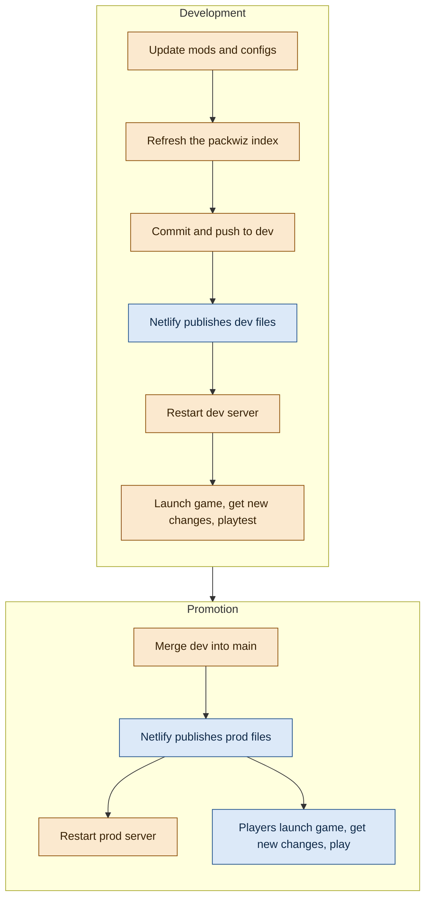

This post serves as something of a retrospective on one of my favorite projects: a giant Minecraft modpack and server collectively called "Sparecraft". Sparecraft 2.0, the most recent instance, was the fourth entry in an annual Minecraft server tradition I had with a group of friends through college. Each year we would reset to a new world with me as the ongoing server admin. I started off on services like PebbleHost, but eventually moved to a cloud VM, since mods were introduced after the first iteration and needed more resources that were quite expensive on managed platforms.

The technical side of the server improved every year, although in truth, administration and distribution remained janky and unpredictable. But in spring of 2023, while building the fourth server, I discovered a little tool called [`packwiz`.](https://packwiz.infra.link/) It excited me. It wound up being quite excellent, and channeled my fresh-grad knowledge and enthusiasm into a modpack distribution system that I ended up being pretty proud of.
## Declare
The source of truth for the entire pack was a git repo. Each mod is one small file, `mods/<name>.pw.toml`, which declares metadata for the actual packwiz binary to make use of. An `index.toml` and `pack.toml` listed every file in the pack — not just the mods, but everything — and the hash of that inventory, respectively. Thus, `pack.toml` becomes the natural "switch" for the repo: if the `index.toml`'s hash changes, then some new change in the pack has occurred. This was the core of the update functionality.
## Publish
The Sparecraft repo was deployed to the Internet so that a client could download `pack.toml` and other configs. This was fairly simple and could be done with any hosting service, though I used Netlify at the time.

Each mod file declares its "side" as being `client`, `server`, or both. However, those are the only files that make such a distinction. Any repo file that clients would not need I added to a `.packwizignore` file. I was perhaps a little sloppy with this, and people probably had a `compose.yaml` or other server-side configs on their instances at various points.
## Fetch
One of the best parts about packwiz is that it wasn't just a pack-building solution: it had a proper distribution side to it as well! A custom Minecraft launcher could run a `packwiz-installer-bootstrap.jar` instead of the normal client. Once you point it to a URL, every time you launch the game, that bootstrapper will check the `pack.toml` for a hash change, which in turn triggers a diff check and an update of the client instance. This includes automated client-side mod downloads from their original hosts, including Modrinth and CurseForge. So, all I needed to do was send everyone a premade MultiMC/Prism Launcher instance zipfile, which they in turn could just import and run. No more need to download binaries by hand!
## Run
The whole server was declared in a `compose.yaml` which used the `itzg/minecraft-server` container image. That held an impressive amount of configs, and the image even had built-in support for packwiz, so the mod download was automated server-side as well as client-side. There was no kind of GitOps running, so the repo was updated manually. I actually developed most of the pack updates on the host itself, for better or for worse.
## Development environment
At the time, I had just begun working for a tech company full-time after a yearlong internship. It was all my first exposure to separate environments for apps as they went through the deployment process. Why not do that for my Minecraft server too? Thus, two aspects of the project were born: the beta, and the development environment. 

The beta came first as a monthlong trial of the modpack as it was in development. This was valuable, but in retrospect, it may not have been a great idea to encourage my friends to play on a server with a doomsday clock on it. All things considered, they took it pretty well when its time was up.

The development environment was set up after the initial go-live of the "stable" server. This idea had potential in concept: a separate MultiMC instance pulled from a URL pointing at the `dev` branch of the repo. I used it to playtest a separate development server. 

The trouble with this, in the end, was twofold. For one, the dev server was relatively useless as a testing environment because I was the only one who used it. The primary issues that I was trying to solve and test were usually performance-related, and those performance issues generally stemmed from the particulars of the actual world that people were building in production. I did not think at the time to mirror the prod world into the dev one, but even if I had, I was still only one concurrent player. In addition, a separate dev environment was generally a lot to maintain and too much overhead for what was ultimately a Minecraft server for me and people I knew.
## Documentation
I eventually got sick of constantly editing installation instructions on Discord, and so ended up building an entire MkDocs documentation site for the pack. It covered installation, misc guides, FAQ, and a complete modlist. It was my first time working with MkDocs and I loved it.
## Gathering feedback
There was simply no way for me to keep track of all the feedback, both verbal and text. So, I turned to my ol' reliable Trello and asked everyone to put their feedback into a basic kanban board where I could label and triage it. Some people really did add their issues to the board, but for the most part I just added new cards when I received informal feedback from someone. As you might expect, the backlog quickly outgrew my own capacity to deal with it, and in the end only a handful of cards were truly marked "done".

## Final pipeline
In the end, the deployment and distribution system still wound up having several manual steps, but the final pipeline was a massive improvement:

## Looking back
Sparecraft was decommed in 2025. At the time of writing, I have not hosted another modpack since then (although I still run vanilla servers for people). This is partly due to the well-known "[Minecraft phase](https://knowyourmeme.com/memes/2-week-minecraft-phase)" phenomenon where interest tapers off quickly, but also due to people generally becoming busier with real life. It did not help that the server suffered from increasingly poor performance that ended with continual crashes. I did not have the kind of knowledge needed to truly solve the root causes, despite working with profilers like Spark somewhat successfully to narrow things down to a few suspects. 

I can certainly think of a few things I could have done to improve things. You might think that, given the obvious overengineering of this whole project, that would mean simplicity... but that's no fun. Maybe using GitOps to automate server updates, or building a CI pipeline to publish smaller artifacts, or deploying the whole shebang on Kubernetes instead of plain Docker! Of course, though, those are small improvements compared to being able to optimize the server itself. Interactions between different mods of varying quality are incredibly difficult to manage at this kind of scale, and the issues are sometimes with the mod itself and somehow *not* your kitchen-sink modpack. I'm fairly confident that AI agents would make short work of such complex issues today, so that is definitely something I would love to try in the future. Maybe by then, [Pumpkin](https://pumpkinmc.org/) will be ready to use...
